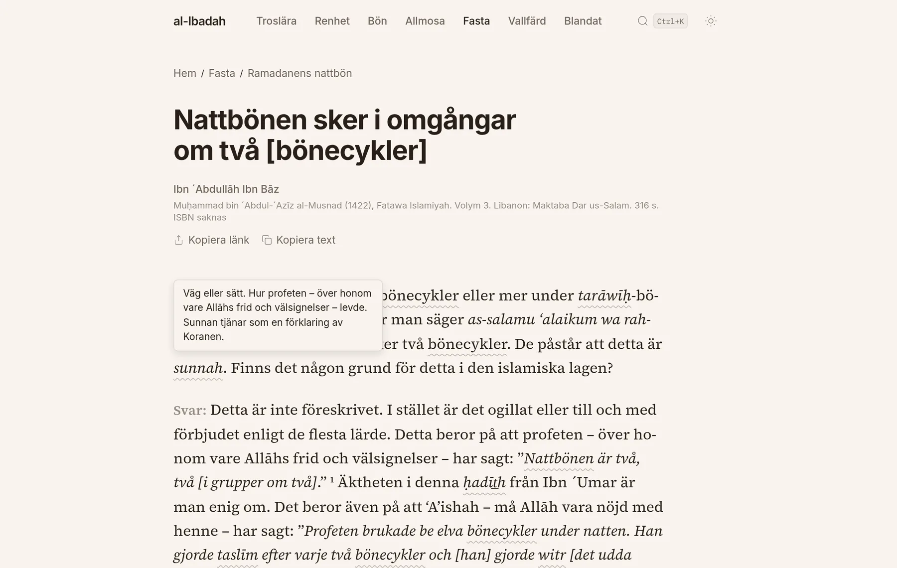
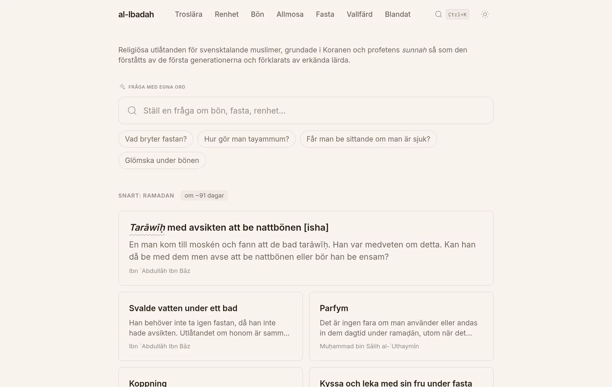
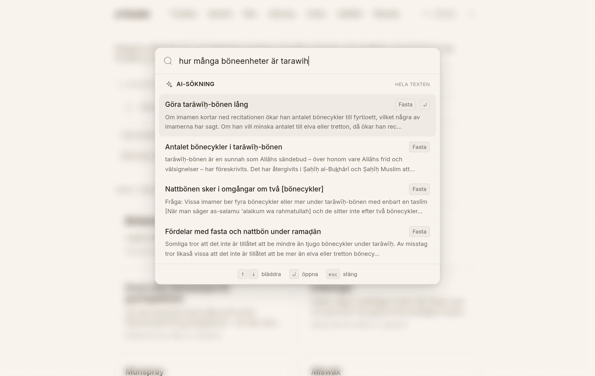
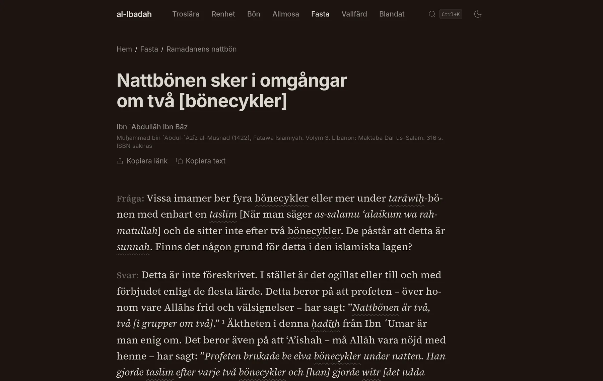
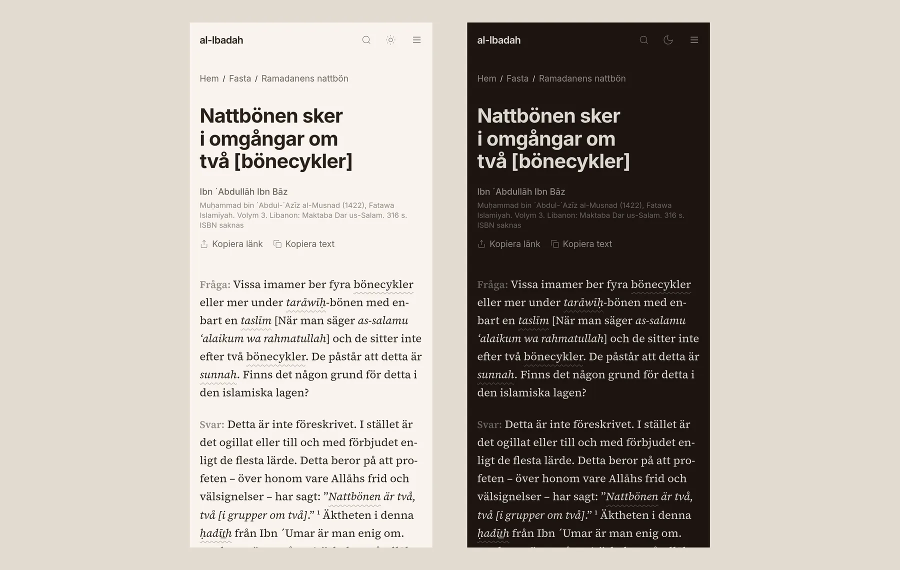

<h1 align="center">al-Ibadah</h1>

<p align="center">
  Islamic rulings in Swedish: 1,653 answers from recognised scholars,<br>
  translated, sourced and set for reading.
</p>

<p align="center">
  <a href="https://al-ibadah.com"><b>al-ibadah.com</b></a> ·
  <a href="#development">Development</a> ·
  <a href="CONTRIBUTING.md">Contributing</a> ·
  <a href="#license">License</a>
</p>

<p align="center">
  <a href="https://github.com/YunusAndreasson/al-ibadah.com/actions/workflows/verify.yml"></a>
  <a href="LICENSE"></a>
  <a href="content/LICENSE"></a>
</p>

<br>



al-Ibadah (العبادة, worship) collects fatwas by scholars such as Ibn Bāz,
Muḥammad bin Sālih al-´Uthaymīn and the Permanent Committee, translated into
Swedish. Each article is one question and its answer, with the book it comes
from. The texts are the product, so the site is built to be read: one serif
column, no ads, no analytics and no cookies.

## Features

- **Set for long reading.** Source Serif 4 at a 65-character measure for the
  text, Inter for the interface. The fonts are self-hosted subsets that
  include the combining marks the transliteration needs (k̲h, s̲h), which the
  standard Latin slices leave out.
- **A glossary inside the text.** 271 Arabic terms, each with one canonical
  transliteration. At build time a remark plugin finds every italicised term
  and attaches its definition, which opens on hover or tap, so a reader never
  leaves the page to look a word up. Footnotes open the same way.
- **The Hijri calendar picks the homepage.** The build converts the date to
  the Islamic calendar and leads with what's coming: Ramadan, the Hajj season,
  the day of Arafah, the Eids, Ashura.
- **Search by title or by question.** Ctrl+K filters titles and Arabic terms
  as you type, from a static index, without needing the diacritics: `tarawih`
  finds tarāwīḥ. A question in your own words goes to
  Cloudflare AI Search, retrieval only: the answer is the scholar's own
  passage with a link to the article, never text a model wrote.
- **Twenty years of links still work.** The old PHP site served articles at
  `/index.php?article=N`. A Pages Functions middleware sends each of the 1,651
  old ids to its article with a 301.
- **Also a book.** `pnpm pdf` typesets every article into one PDF with Typst,
  with real footnotes and Swedish hyphenation.

<table>
  <tr>
    <td width="50%"></td>
    <td width="50%"></td>
  </tr>
  <tr>
    <td align="center"><sub><b>Homepage</b>, three months before Ramadan</sub></td>
    <td align="center"><sub><b>Search</b>, a question in plain Swedish</sub></td>
  </tr>
  <tr>
    <td width="50%"></td>
    <td width="50%"></td>
  </tr>
  <tr>
    <td align="center"><sub><b>Dark mode</b>, following the system or a toggle</sub></td>
    <td align="center"><sub><b>On a phone</b>, light and dark</sub></td>
  </tr>
</table>

## Development

Node 22.23 or newer and pnpm 11 (pinned under `packageManager`).

```sh
pnpm install
pnpm dev       # http://localhost:4321
pnpm verify    # what CI runs: lint, unused code, type check, validation, build
```

| Command | What it does |
| --- | --- |
| `pnpm dev` | Dev server |
| `pnpm build` | Legacy redirect map, content and transliteration validation, then the static build into `dist/` |
| `pnpm verify` | `lint` + `knip` + `typecheck` + `build` |
| `pnpm validate` | Frontmatter and Markdown structure of every article |
| `pnpm validate:terms` | Arabic terms against the canonical spellings |
| `pnpm extract:glossary` | Regenerates `src/data/glossary.ts` from the terms file and the articles' footnotes |
| `pnpm pdf` | The collected volume, `dist/samlingsvolym.pdf` (needs [Typst](https://typst.app)) |
| `pnpm og:image` | Renders the social card, `public/og-image.png`, from `scripts/og-image.html` |
| `pnpm deploy` | Build, PDF, and upload to Cloudflare Pages |

The Pages Functions don't run under `pnpm dev`; try them with
`pnpm build && pnpm exec wrangler pages dev dist`.

### Layout

```
content/              the articles, one Markdown file per URL
src/pages/            routes: categories, subcategories, articles, glossary, RSS
src/components/       Astro components and the Preact islands (search, menu, theme, share)
src/lib/hijri/        Hijri conversion and occasion detection
src/data/             italicized-terms.json (the glossary's source) and generated data
plugins/              remark-glossary-terms, rehype-qa-labels
functions/            Cloudflare Pages Functions: legacy redirects, /api/search
scripts/              validation, generators, PDF, font subsetting
```

Markdown goes through unified: `remark-gfm`, `remark-smartypants`, the
glossary plugin, then `rehype-raw`, `rehype-slug` and the plugin that styles
the **Fråga:** and **Svar:** labels. An article's frontmatter:

```yaml
title: 'Nattbönen sker i omgångar om två [bönecykler]'
author: Ibn ´Abdullāh Ibn Bāz
source: Muḥammad bin ´Abdul-´Azīz al-Musnad (1422), Fatawa Islamiyah. Volym 3. …
categories: [Fasta (Sawm), Ramadanens nattbön]
original_id: 1410           # the old /index.php?article= id, for the redirect
description: 'Detta är inte föreskrivet. …'
```

### Deploy

`pnpm deploy` uploads `dist/` to the Cloudflare Pages project `al-ibadah`
(production branch `main`) by direct upload. It needs `wrangler login`; there
is no deploy from CI.

## Under the hood

- [Astro 7](https://astro.build), static output, with
  [Preact](https://preactjs.com) islands
- [Tailwind CSS 4](https://tailwindcss.com)
- [unified](https://unifiedjs.com) with remark and rehype for the Markdown
- [hijri-rrule](https://www.npmjs.com/package/hijri-rrule) for the Islamic
  calendar
- [Typst](https://typst.app) for the PDF
- [Cloudflare Pages](https://pages.cloudflare.com) and
  [AI Search](https://developers.cloudflare.com/ai-search/)
- [Biome](https://biomejs.dev) and [knip](https://knip.dev) for lint and
  unused code

## License

The code is [MIT](LICENSE). The Swedish translations in `content/` are
[CC BY 4.0](content/LICENSE): share and adapt them freely, crediting
al-Ibadah as the source.
